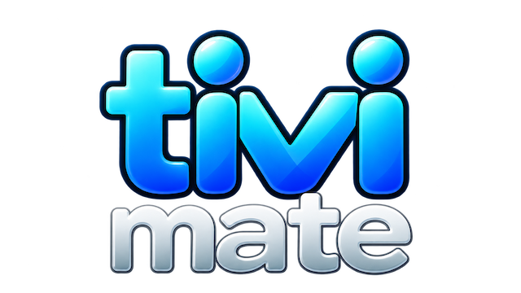
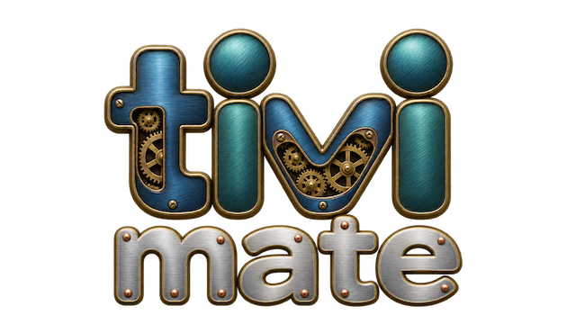
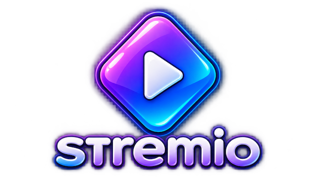
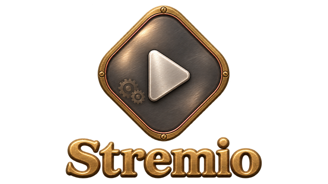
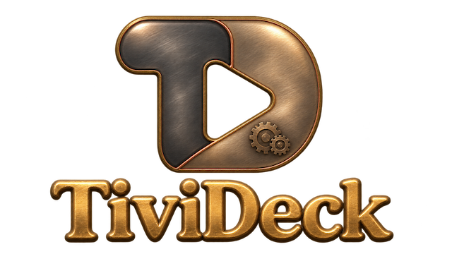
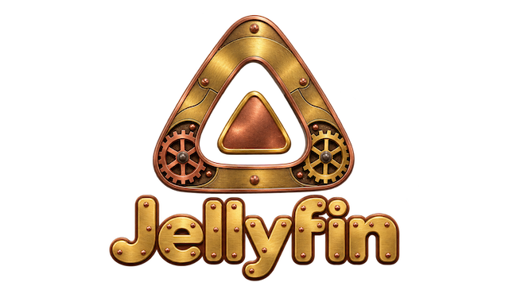
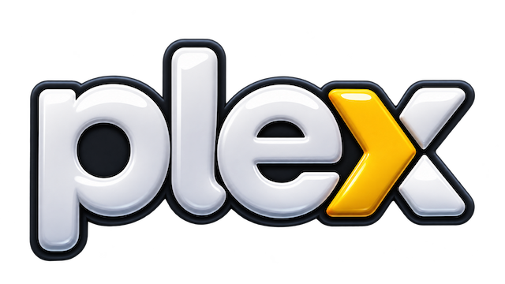
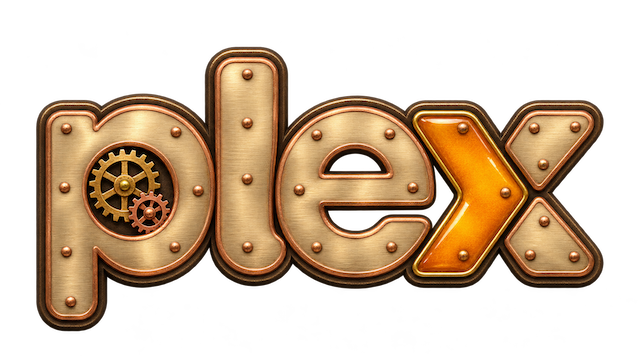
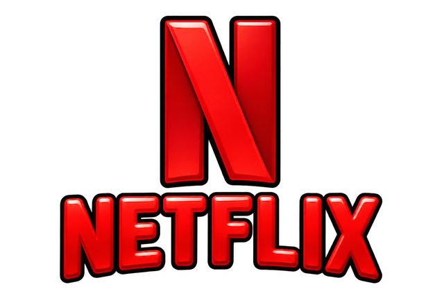
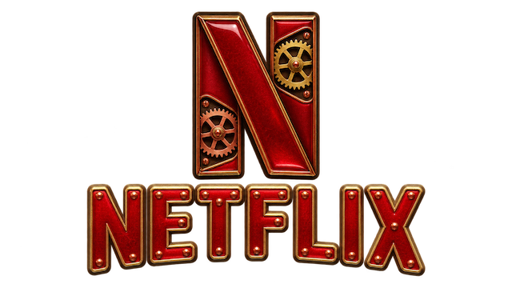

# Projectivy Transparent Icons

## Support this project

If you enjoy these icons, consider supporting the project on Ko-fi. Donations are optional and appreciated!

## [Browse and search icons →](https://drzacharysmith.github.io/projectivy-transparent-icons/)

Click the link above to open the gallery. Search by app name or scroll to browse, then click any icon to download its original PNG.

A collection of **589 transparent PNG icons** for customizing Projectivy Launcher on Android TV and Google TV.

## Request an icon

Want an icon added? [Open an icon request](https://github.com/DrZacharySmith/projectivy-transparent-icons/issues/new).

Please include the app name, a link to the app or its logo.

## Download

Open the [icon gallery](https://drzacharysmith.github.io/projectivy-transparent-icons/).
Search by app name across both styles, or use the **Icon style** menu to filter by Glossy Cartoon or Steampunk.

- **One icon** — Click the icon or **Download PNG** to save the original transparent PNG.
- **Several icons** — Check **Select** on each icon you want. Selections stay checked when you change searches or switch styles. Click **Download selected ZIP**, then extract the archive.
- **Entire collection** — On GitHub, choose **Code → Download ZIP**. Extract the archive and open `icons/styles/` to find both styles. The ZIP also includes the other repository files.

Copy the PNGs to a location your TV can access, then use Projectivy Launcher's icon customization options to select an image for an app or shortcut.

## Gallery

[Browse and search all icons →](https://drzacharysmith.github.io/projectivy-transparent-icons/)

| Glossy Cartoon | Steampunk | Glossy Cartoon | Steampunk | Glossy Cartoon | Steampunk |
| :---: | :---: | :---: | :---: | :---: | :---: |
|  |  |  |  |  |  |
|  |  |  |  |  |  |

## Image details

All icons include alpha transparency. Original artwork, dimensions, and filenames are preserved. Most images are approximately 16:9; Cache Cleaner is 2:1. The `16x9` filenames are descriptive and do not guarantee an exact aspect ratio.

## AI disclosure

These icons were generated using artificial intelligence (AI). They are unofficial, AI-generated interpretations of app branding.

## Credits and trademarks

This is an unofficial, community icon collection and is not affiliated with Projectivy Launcher or the apps represented. App names, logos, and trademarks belong to their respective owners. Inclusion here does not grant rights to third-party branding.
