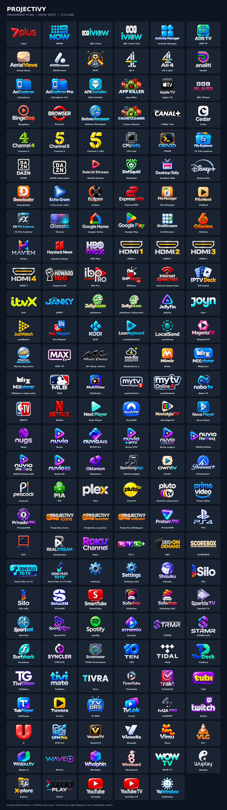

# Projectivy Transparent Icons

A collection of **173 transparent PNG icons** for customizing Projectivy Launcher on Android TV and Google TV.

## Request an icon

Want an icon added? [Open an icon request](https://github.com/DrZacharySmith/projectivy-transparent-icons/issues/new).

Please include the app name, a link to the app or its logo.

## Download

- **Individual icon:** click its name in the gallery, then choose **Download raw file** on GitHub.
- **Entire collection:** choose **Code → Download ZIP**, then extract the archive.

Copy the PNGs to a location your TV can access, then use Projectivy Launcher’s icon customization options to select an image for an app or shortcut. Menu wording may vary by version.

## Gallery

<strong>Browse all 173 icons — click to collapse or expand</strong>

Click an image or name to open its PNG, then choose **Download raw file**.

| | | |
| :---: | :---: | :---: |
|  <a href="icons/7plus-16x9.png">7plus</a> |  <a href="icons/9NOW-16x9.png">9NOW</a> |  <a href="icons/ABC%20iview-16x9.png">ABC iview</a> |
|  <a href="icons/ABC%20iview%20%28alt%29-16x9.png">ABC iview (alt)</a> |  <a href="icons/Activity%20Manager-16x9.png">Activity Manager</a> |  <a href="icons/ADB%20TV-16x9.png">ADB TV</a> |
|  <a href="icons/Aerial%20Views-16x9.png">Aerial Views</a> |  <a href="icons/AIOStreams-16x9.png">AIOStreams</a> |  <a href="icons/AK47-16x9.png">AK47</a> |
|  <a href="icons/All%204-16x9.png">All 4</a> |  <a href="icons/All%204%20%28alt%29-16x9.png">All 4 (alt)</a> |  <a href="icons/Analiti-16x9.png">Analiti</a> |
|  <a href="icons/AnExplorer-16x9.png">AnExplorer</a> |  <a href="icons/AnExplorer%20Pro-16x9.png">AnExplorer Pro</a> |  <a href="icons/APK%20Installer-16x9.png">APK Installer</a> |
|  <a href="icons/App%20Killer-16x9.png">App Killer</a> |  <a href="icons/Apple%20TV-16x9.png">Apple TV</a> |  <a href="icons/BBC%20iPlayer-16x9.png">BBC iPlayer</a> |
|  <a href="icons/BingeBop-16x9.png">BingeBop</a> |  <a href="icons/Browser-16x9.png">Browser</a> |  <a href="icons/Buttons%20Remapper-16x9.png">Buttons Remapper</a> |
|  <a href="icons/Cache%20Cleaner-16x9.png">Cache Cleaner</a> |  <a href="icons/CANAL%20Plus-16x9.png">CANAL Plus</a> |  <a href="icons/Cedar-16x9.png">Cedar</a> |
|  <a href="icons/Channel%204-16x9.png">Channel 4</a> |  <a href="icons/Channel%205-16x9.png">Channel 5</a> |  <a href="icons/Channel%205%20%28alt%29-16x9.png">Channel 5 (alt)</a> |
|  <a href="icons/CPU%20Info-16x9.png">CPU Info</a> |  <a href="icons/CRIVID-16x9.png">CRIVID</a> |  <a href="icons/CX%20File%20Explorer-16x9.png">CX File Explorer</a> |
|  <a href="icons/DAZN-16x9.png">DAZN</a> |  <a href="icons/DAZN%20%28alt%29-16x9.png">DAZN (alternate)</a> |  <a href="icons/Debrid%20Stream-16x9.png">Debrid Stream</a> |
|  <a href="icons/DefSquid-16x9.png">DefSquid</a> |  <a href="icons/Desktop%20Telly-16x9.png">Desktop Telly</a> |  <a href="icons/Disney%20Plus-16x9.png">Disney Plus</a> |
|  <a href="icons/Downloader-16x9.png">Downloader</a> |  <a href="icons/Echo%20Gram%2016x9.png">Echo Gram 16x9</a> |  <a href="icons/Eclipse-16x9.png">Eclipse</a> |
|  <a href="icons/ExpressVPN-16x9.png">ExpressVPN</a> |  <a href="icons/File%20Manager-16x9.png">File Manager</a> |  <a href="icons/FlixNest-16x9.png">FlixNest</a> |
|  <a href="icons/FX%20File%20Explorer-16x9.png">FX File Explorer</a> |  <a href="icons/Glassio-16x9.png">Glassio</a> |  <a href="icons/Google%20Home-16x9.png">Google Home</a> |
|  <a href="icons/Google%20Play-16x9.png">Google Play</a> |  <a href="icons/GridStreamr-16x9.png">GridStreamr</a> |  <a href="icons/GSeries-16x9.png">GSeries</a> |
|  <a href="icons/Haven-16x9.png">Haven</a> |  <a href="icons/Haystack%20News-16x9.png">Haystack News</a> |  <a href="icons/HBO%20Max-16x9.png">HBO Max</a> |
|  <a href="icons/HDMI%201-16x9.png">HDMI 1</a> |  <a href="icons/HDMI%202-16x9.png">HDMI 2</a> |  <a href="icons/HDMI%203-16x9.png">HDMI 3</a> |
|  <a href="icons/HDMI%204-16x9.png">HDMI 4</a> |  <a href="icons/Howard%20100-16x9.png">Howard 100</a> |  <a href="icons/IBO%20Pro-16x9.png">IBO Pro</a> |
|  <a href="icons/iMPlayer-16x9.png">iMPlayer</a> |  <a href="icons/Internet%20Speed%20Test-16x9.png">Internet Speed Test</a> |  <a href="icons/IPTV%20Deck-16x9.png">IPTV Deck</a> |
|  <a href="icons/itvX-16x9.png">itvX</a> |  <a href="icons/JANKY-16x9.png">JANKY</a> |  <a href="icons/Jellybeam-16x9.png">Jellybeam</a> |
|  <a href="icons/Jellybeam.png">Jellybeam (alternate)</a> |  <a href="icons/Jellyfin-16x9.png">Jellyfin</a> |  <a href="icons/Joyn-16x9.png">Joyn</a> |
|  <a href="icons/JustWatch-16x9.png">JustWatch</a> |  <a href="icons/Key%20Mapper-16x9.png">Key Mapper</a> |  <a href="icons/Kodi-16x9.png">Kodi</a> |
|  <a href="icons/LeanKeyboard-16x9.png">LeanKeyboard</a> |  <a href="icons/LocalSend-16x9.png">LocalSend</a> |  <a href="icons/MagentaTV-16x9.png">MagentaTV</a> |
|  <a href="icons/Marine%20Aquarium-16x9.png">Marine Aquarium</a> |  <a href="icons/MAX%20TV-16x9.png">MAX TV</a> |  <a href="icons/MC%20Music%20Choice-16x9.png">MC Music Choice</a> |
|  <a href="icons/MediaStorm%20x-16x9.png">MediaStorm x</a> |  <a href="icons/Mimir-16x9.png">Mimir</a> |  <a href="icons/MiXplorer-16x9.png">MiXplorer</a> |
|  <a href="icons/MiXplorer%20%28alt%29-16x9.png">MiXplorer (alternate)</a> |  <a href="icons/MLB-16x9.png">MLB</a> |  <a href="icons/Multiview-16x9.png">Multiview</a> |
|  <a href="icons/mytvOnline3-16x9.png">mytvOnline3</a> |  <a href="icons/mytvOnline4-16x9.png">mytvOnline4</a> |  <a href="icons/Nabo%20TV-16x9.png">Nabo TV</a> |
|  <a href="icons/NBATV-16x9.png">NBATV</a> |  <a href="icons/Netflix-16x9.png">Netflix</a> |  <a href="icons/Next%20Player-16x9.png">Next Player</a> |
|  <a href="icons/NordVPN-16x9.png">NordVPN</a> |  <a href="icons/NostalgiaTV-16x9.png">NostalgiaTV</a> |  <a href="icons/Nova%20Player-16x9.png">Nova Player</a> |
|  <a href="icons/Nugs-16x9.png">Nugs</a> |  <a href="icons/Nuvio-16x9.png">Nuvio</a> |  <a href="icons/NUVIO%20Arc-16x9.png">NUVIO Arc</a> |
|  <a href="icons/Nuvio%20IPTV-16x9.png">Nuvio IPTV</a> |  <a href="icons/Nuvio%20Legacy-16x9.png">Nuvio Legacy</a> |  <a href="icons/NUVIO%20ReSeq-16x9.png">NUVIO ReSeq</a> |
|  <a href="icons/NUVIO%20ReSeq%20%28alt%29-16x9.png">NUVIO ReSeq (alt)</a> |  <a href="icons/Nuvio%20RS-16x9.png">Nuvio RS</a> |  <a href="icons/Obtanium-16x9.png">Obtanium</a> |
|  <a href="icons/OpenSongApp-16x9.png">OpenSongApp</a> |  <a href="icons/Owntv-16x9.png">Owntv</a> |  <a href="icons/Paramount%2B-16x9.png">Paramount+</a> |
|  <a href="icons/Peacock-16x9.png">Peacock</a> |  <a href="icons/PIA-16x9.png">PIA</a> |  <a href="icons/Plex-16x9.png">Plex</a> |
|  <a href="icons/PlutoTV-16x9.png">PlutoTV</a> |  <a href="icons/PlutoTV%28alt%29-16x9.png">PlutoTV (alternate)</a> |  <a href="icons/Prime-16x9.png">Prime Video</a> |
|  <a href="icons/PrivadoVPN-16x9.png">PrivadoVPN</a> |  <a href="icons/Projectivy%20Icons-16x9.png">Projectivy Icons</a> |  <a href="icons/Projectivy%20Launcher-16x9.png">Projectivy Launcher</a> |
|  <a href="icons/Projectivy%20Wallpaper-16x9.png">Projectivy Wallpaper</a> |  <a href="icons/ProtonVPN-16x9.png">ProtonVPN</a> |  <a href="icons/PS4-16x9.png">PS4</a> |
|  <a href="icons/QVC-16x9.png">QVC</a> |  <a href="icons/Realstream-16x9.png">Realstream</a> |  <a href="icons/Roku-16x9.png">Roku</a> |
|  <a href="icons/RTL-16x9.png">RTL+</a> |  <a href="icons/SBS-16x9.png">SBS</a> |  <a href="icons/SCOREBOX-16x9.png">SCOREBOX</a> |
|  <a href="icons/Send%20Files%20to%20TV-16x9.png">Send Files to TV</a> |  <a href="icons/Send%20Files%20to%20TV%20%28alt%29-16x9.png">Send Files to TV (alt)</a> |  <a href="icons/Settings-16x9.png">Settings</a> |
|  <a href="icons/Settings%20%28alt%29-16x9.png">Settings (alt)</a> |  <a href="icons/Shizuku-16x9.png">Shizuku</a> |  <a href="icons/Silo-16x9.png">Silo</a> |
|  <a href="icons/Silo%20%28alt%29-16x9.png">Silo (alt)</a> |  <a href="icons/SiriusXM-16x9.png">SiriusXM</a> |  <a href="icons/SmartTube-16x9.png">SmartTube</a> |
|  <a href="icons/Sofadrop-16x9.png">Sofadrop</a> |  <a href="icons/Sofadrop%20%28alt%29-16x9.png">Sofadrop (alt)</a> |  <a href="icons/Sparkle%20TV-16x9.png">Sparkle TV</a> |
|  <a href="icons/Sportset-16x9.png">Sportset</a> |  <a href="icons/SportzXTV-16x9.png">SportzXTV</a> |  <a href="icons/Spotify-16x9.png">Spotify</a> |
|  <a href="icons/Stremio-16x9.png">Stremio</a> |  <a href="icons/STRMR-16x9.png">STRMR</a> |  <a href="icons/STRMR%20%28alt%29-16x9.png">STRMR (alt)</a> |
|  <a href="icons/Surfshark-16x9.png">Surfshark</a> |  <a href="icons/SYNCLER-16x9.png">SYNCLER</a> |  <a href="icons/TDUK%20Screensaver-16x9.png">TDUK Screensaver</a> |
|  <a href="icons/TEN-16x9.png">TEN</a> |  <a href="icons/Tidal-16x9.png">Tidal</a> |  <a href="icons/TiviDeck-16x9.png">TiviDeck</a> |
|  <a href="icons/TiviGlass-16x9.png">TiviGlass</a> |  <a href="icons/TiviMate-16x9.png">TiviMate</a> |  <a href="icons/Tivra-16x9.png">Tivra</a> |
|  <a href="icons/TizenTube-16x9.png">TizenTube</a> |  <a href="icons/Trakt16x9.png">Trakt16x9</a> |  <a href="icons/Tubi-16x9.png">Tubi</a> |
|  <a href="icons/TubPlayer-16x9.png">TubPlayer</a> |  <a href="icons/Tuvora-16x9.png">Tuvora</a> |  <a href="icons/TV%20BRO-16x9.png">TV BRO</a> |
|  <a href="icons/TvLok-16x9.png">TvLok</a> |  <a href="icons/tvQAPRO-16x9.png">tvQAPRO</a> |  <a href="icons/Twitch-16x9.png">Twitch</a> |
|  <a href="icons/U-16x9.png">U</a> |  <a href="icons/UFM%20Pro-16x9.png">UFM Pro</a> |  <a href="icons/VesperTV-16x9.png">VesperTV</a> |
|  <a href="icons/Viewella-16x9.png">Viewella</a> |  <a href="icons/Vimu%20-%2016x9.png">Vimu</a> |  <a href="icons/VLC-16x9.png">VLC</a> |
|  <a href="icons/%20Waipu%20tv-16x9.png">Waipu tv</a> |  <a href="icons/Waveo-16x9.png">Waveo</a> |  <a href="icons/Wholphin-16x9.png">Wholphin</a> |
|  <a href="icons/WireGuard-16x9.png">WireGuard</a> |  <a href="icons/WOW%20TV-16x9.png">WOW TV</a> |  <a href="icons/Wuplay-16x9.png">Wuplay</a> |
|  <a href="icons/X-plore-16x9.png">X-plore</a> |  <a href="icons/Xumo-16x9.png">Xumo</a> |  <a href="icons/YouTube-16x9.png">YouTube</a> |
|  <a href="icons/YouTube%20TV-16x9.png">YouTube TV</a> |  <a href="icons/YoWindow-16x9.png">YoWindow</a> |  |

## Image details

All icons include alpha transparency. Original artwork, dimensions, and filenames are preserved. Most images are approximately 16:9; Cache Cleaner is 2:1. The `16x9` filenames are descriptive and do not guarantee an exact aspect ratio.

## AI disclosure

These icons were generated using artificial intelligence (AI). They are unofficial, AI-generated interpretations of app branding.

## Credits and trademarks

This is an unofficial, community icon collection and is not affiliated with Projectivy Launcher or the apps represented. App names, logos, and trademarks belong to their respective owners. Inclusion here does not grant rights to third-party branding.
