# Projectivy Transparent Icons

A collection of **76 transparent PNG icons** for customizing Projectivy Launcher on Android TV and Google TV.

## Request an icon

Want an icon added? [Open an icon request](https://github.com/DrZacharySmith/projectivy-transparent-icons/issues/new).

Please include the app name, a link to the app or its logo.

## Download

- **Individual icon:** click its name in the gallery, then choose **Download raw file** on GitHub.
- **Entire collection:** choose **Code → Download ZIP**, then extract the archive.

Copy the PNGs to a location your TV can access, then use Projectivy Launcher’s icon customization options to select an image for an app or shortcut. Menu wording may vary by version.

## Gallery

<strong>Browse all 76 icons — click to collapse or expand</strong>

Click an image or name to open its PNG, then choose **Download raw file**.

| | | |
| :---: | :---: | :---: |
|  [Aerial Views](icons/Aerial%20Views-16x9.png) |  [AIOStreams](icons/AIOStreams-16x9.png) |  [App Killer](icons/App%20Killer-16x9.png) |
|  [Apple TV](icons/Apple%20TV-16x9.png) |  [Buttons Remapper](icons/Buttons%20Remapper-16x9.png) |  [Cache Cleaner](icons/Cache%20Cleaner-16x9.png) |
| [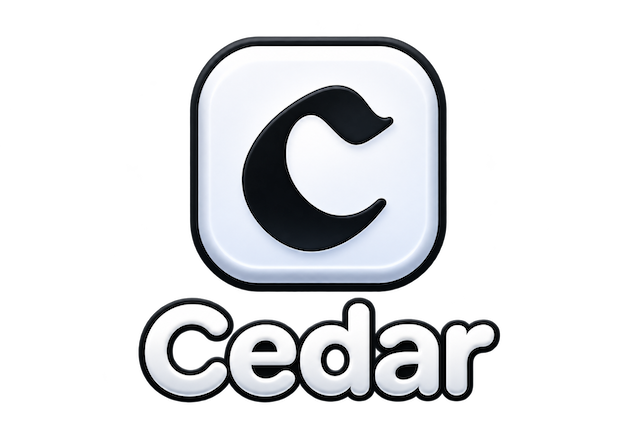](icons/Cedar-16x9.png) [Cedar](icons/Cedar-16x9.png) |  [Channel 4](icons/Channel%204-16x9.png) |  [CPU Info](icons/CPU%20Info-16x9.png) |
| [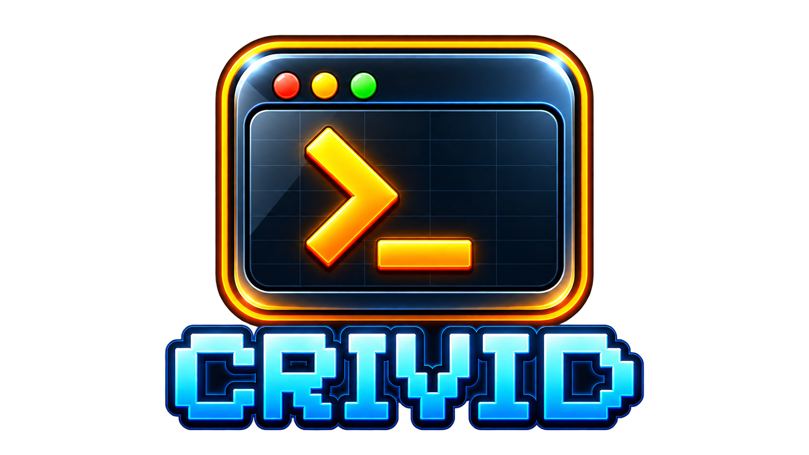](icons/CRIVID-16x9.png) [CRIVID](icons/CRIVID-16x9.png) |  [DAZN](icons/DAZN-16x9.png) |  [DAZN (alternate)](icons/DAZN%20%28alt%29-16x9.png) |
|  [Debrid Stream](icons/Debrid%20Stream-16x9.png) |  [DefSquid](icons/DefSquid-16x9.png) |  [Downloader](icons/Downloader-16x9.png) |
|  [File Manager](icons/File%20Manager-16x9.png) |  [FlixNest](icons/FlixNest-16x9.png) |  [Google Play](icons/Google%20Play-16x9.png) |
| [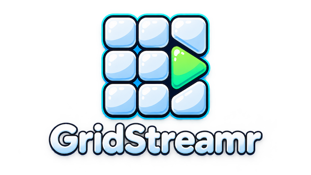](icons/GridStreamr-16x9.png) [GridStreamr](icons/GridStreamr-16x9.png) |  [GSeries](icons/GSeries-16x9.png) |  [HBO Max](icons/HBO%20Max-16x9.png) |
|  [iMPlayer](icons/iMPlayer-16x9.png) |  [Internet Speed Test](icons/Internet%20Speed%20Test-16x9.png) | [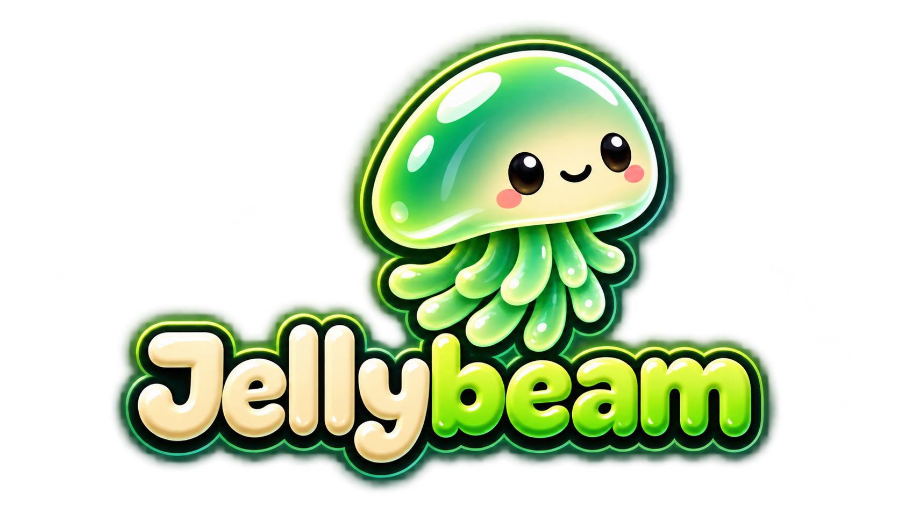](icons/Jellybeam-16x9.png) [Jellybeam](icons/Jellybeam-16x9.png) |
| [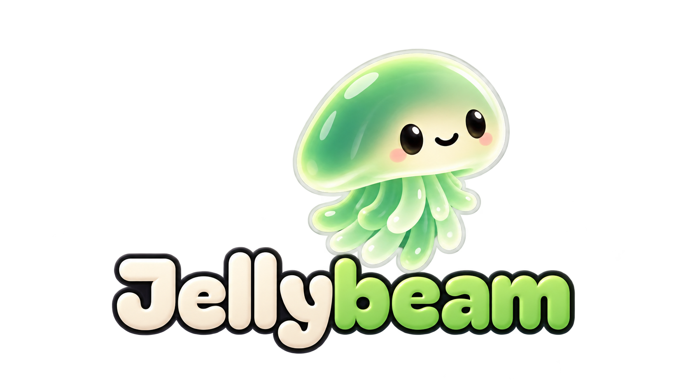](icons/Jellybeam.png) [Jellybeam (alternate)](icons/Jellybeam.png) | [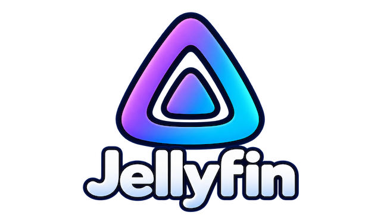](icons/Jellyfin-16x9.png) [Jellyfin](icons/Jellyfin-16x9.png) |  [Joyn](icons/Joyn-16x9.png) |
|  [JustWatch](icons/JustWatch-16x9.png) |  [LocalSend](icons/LocalSend-16x9.png) |  [MagentaTV](icons/MagentaTV-16x9.png) |
|  [MediaStorm x](icons/MediaStorm%20x-16x9.png) |  [Mimir](icons/Mimir-16x9.png) |  [MiXplorer](icons/MiXplorer-16x9.png) |
|  [MiXplorer (alternate)](icons/MiXplorer%20%28alt%29-16x9.png) | [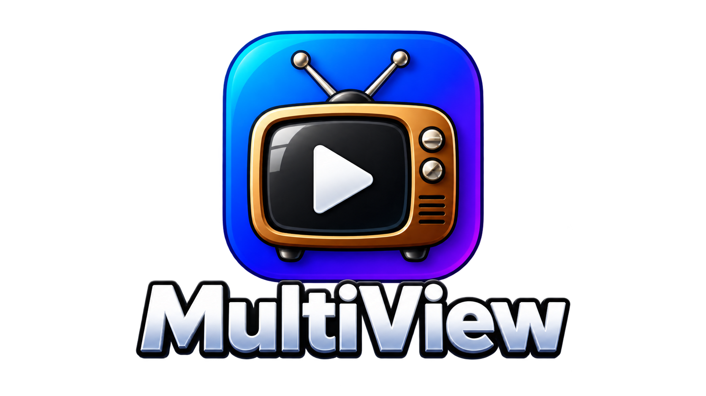](icons/Multiview-16x9.png) [Multiview](icons/Multiview-16x9.png) |  [mytvOnline3](icons/mytvOnline3-16x9.png) |
|  [Nabo TV](icons/Nabo%20TV-16x9.png) | [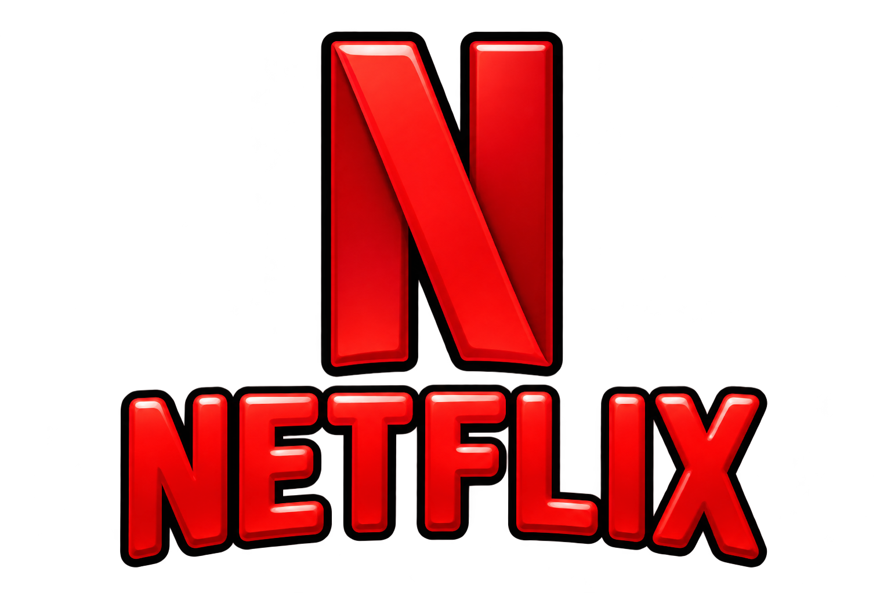](icons/Netflix-16x9.png) [Netflix](icons/Netflix-16x9.png) | [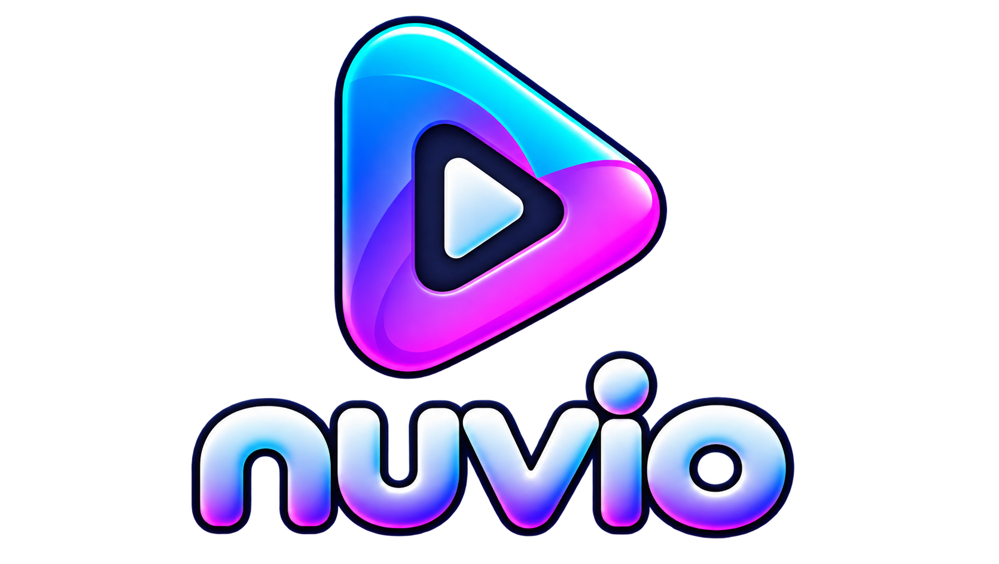](icons/Nuvio-16x9.png) [Nuvio](icons/Nuvio-16x9.png) |
|  [Nuvio IPTV](icons/Nuvio%20IPTV-16x9.png) |  [Paramount+](icons/Paramount%2B-16x9.png) | [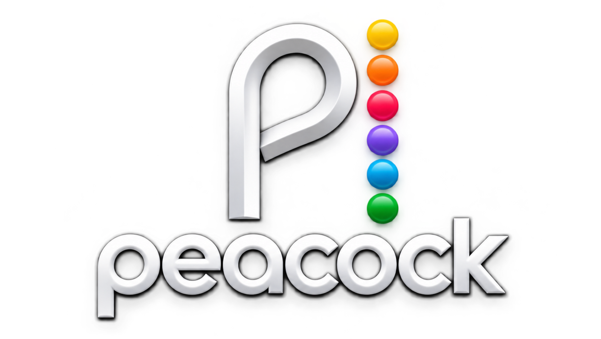](icons/Peacock-16x9.png) [Peacock](icons/Peacock-16x9.png) |
|  [Plex](icons/Plex-16x9.png) |  [PlutoTV](icons/PlutoTV-16x9.png) |  [PlutoTV (alternate)](icons/PlutoTV%28alt%29-16x9.png) |
|  [Prime Video](icons/Prime-16x9.png) |  [Projectivy Icons](icons/Projectivy%20Icons-16x9.png) |  [Projectivy Wallpaper](icons/Projectivy%20Wallpaper-16x9.png) |
|  [ProtonVPN](icons/ProtonVPN-16x9.png) |  [Roku](icons/Roku-16x9.png) |  [RTL+](icons/RTL-16x9.png) |
|  [SmartTube](icons/SmartTube-16x9.png) |  [Sportset](icons/Sportset-16x9.png) |  [SportzXTV](icons/SportzXTV-16x9.png) |
|  [Spotify](icons/Spotify-16x9.png) |  [Stremio](icons/Stremio-16x9.png) | [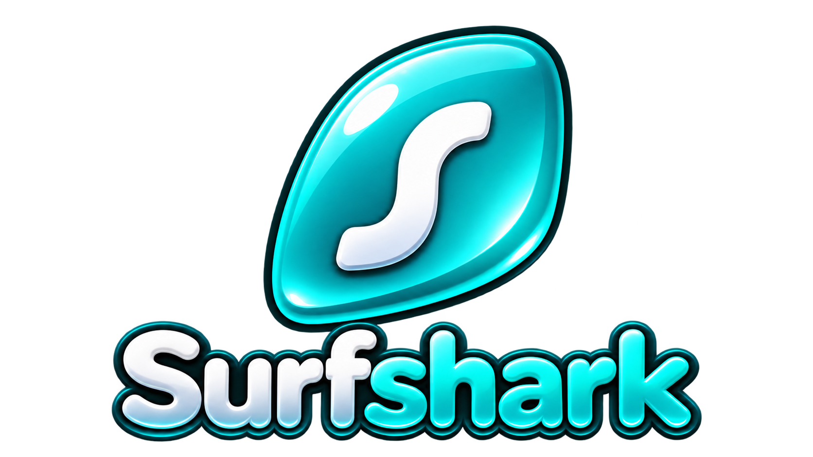](icons/Surfshark-16x9.png) [Surfshark](icons/Surfshark-16x9.png) |
| [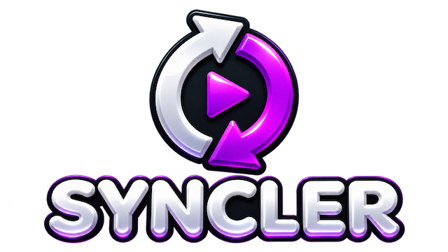](icons/SYNCLER-16x9.png) [SYNCLER](icons/SYNCLER-16x9.png) | [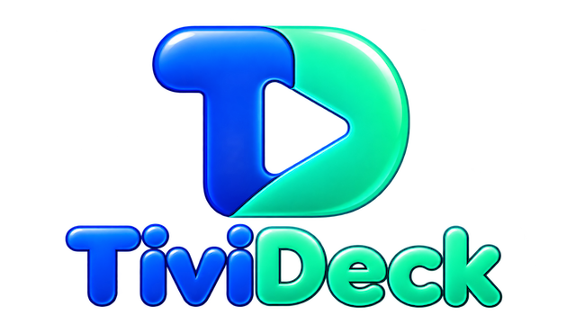](icons/TiviDeck-16x9.png) [TiviDeck](icons/TiviDeck-16x9.png) |  [TiviMate](icons/TiviMate-16x9.png) |
|  [TizenTube](icons/TizenTube-16x9.png) |  [Tubi](icons/Tubi-16x9.png) |  [TubPlayer](icons/TubPlayer-16x9.png) |
|  [Tuvora](icons/Tuvora-16x9.png) |  [TvLok](icons/TvLok-16x9.png) | [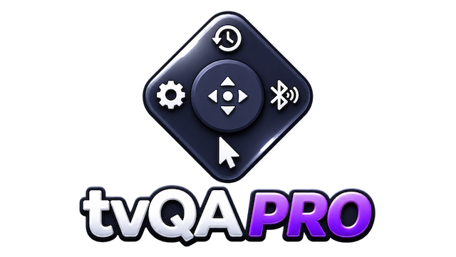](icons/tvQAPRO-16x9.png) [tvQAPRO](icons/tvQAPRO-16x9.png) |
|  [UFM Pro](icons/UFM%20Pro-16x9.png) |  [VesperTV](icons/VesperTV-16x9.png) | [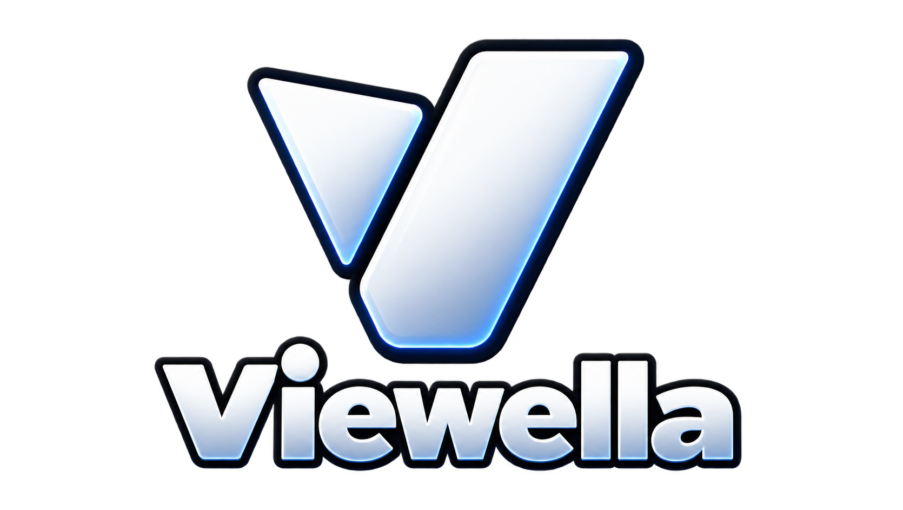](icons/Viewella-16x9.png) [Viewella](icons/Viewella-16x9.png) |
|  [Vimu](icons/Vimu%20-%2016x9.png) |  [VLC](icons/VLC-16x9.png) |  [Waipu tv](icons/%20Waipu%20tv-16x9.png) |
|  [Wholphin](icons/Wholphin-16x9.png) |  [WOW TV](icons/WOW%20TV-16x9.png) |  [X-plore](icons/X-plore-16x9.png) |
|  [YouTube](icons/YouTube-16x9.png) |  |  |

## Image details

All icons include alpha transparency. Original artwork, dimensions, and filenames are preserved. Most images are approximately 16:9; Cache Cleaner is 2:1. The `16x9` filenames are descriptive and do not guarantee an exact aspect ratio.

## AI disclosure

These icons were generated using artificial intelligence (AI). They are unofficial, AI-generated interpretations of app branding.

## Credits and trademarks

This is an unofficial, community icon collection and is not affiliated with Projectivy Launcher or the apps represented. App names, logos, and trademarks belong to their respective owners. Inclusion here does not grant rights to third-party branding.
